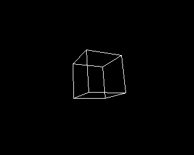

# fast3d

Fast 3D for the 6502, for BeebAsm: signed multiplication, a rotation matrix
from three angles, rotating and projecting vertices, and drawing lines in
MODE 4. With them comes a demo, a wireframe cube or icosahedron turning,
double-buffered. These are the ZX Spectrum's
[fast3d](https://github.com/jonsole/zx-spectrum-emulator/tree/master/examples/fast3d)
routines with the same arithmetic, so a program can share its models and
data between the two machines.

`INCLUDE "fast3d.6502"` before any code that uses its zero page; BeebAsm
needs zero-page symbols defined before use. It aligns its tables itself (2.5K,
on page boundaries). It takes 26 bytes of zero page from `FAST3D_ZP`, which
is &70 unless you set it first.

## The numbers

| What | Form |
|---|---|
| An angle | a byte, 256 to the turn |
| A vertex | three signed bytes, -128..127 |
| A matrix entry | a signed byte, -127..127, with 127 standing for 1.0 |
| A rotated coordinate | the exact 16-bit sum `m0*x + m1*y + m2*z`: 128 times the rotated coordinate (times 127/128) |
| A projected coordinate | `rot / Z`, with `Z = (rot_z + zoff) DIV 256` |

With `zoff = 128 * d`, the projection is `256 * x / (z + d)`: the eye is `d`
units from the object's centre and 256 units from the screen. `Z` must stay
within 1..255. For an object inside a sphere of radius `r`, choose `d`
between `r + 2` and `512 - r`. Projected points land in a 256 x 255 window,
the middle 256 columns of the MODE 4 screen.

[model.mjs](model.mjs) defines every result exactly, and
[check.mjs](check.mjs) holds the 6502 to it.

## The routines

Cycles are at 2MHz, counted by jsbeeb's 6502 with page crossings included;
see [Checking](#checking).

| Routine | In | Out | Cycles |
|---|---|---|---|
| `mul8s` | A, Y signed | A:X = A * Y (high, low) | 70..74 |
| `make_matrix` | `angle_x`, `angle_y`, `angle_z` | `matrix` (9 bytes, row by row), and rotate's code | ~1,700 |
| `rotate` | `vptr` -> vertex | `rot_x`, `rot_y`, `rot_z` | 381..417 |
| `project` | `rot_*`, `zoff` | `screen_x`, `screen_y` and carry clear, or carry set if off the screen | ~360 |
| `divide_unsigned` | A:`div_lo` / `div_by` | A, or carry if it will not fit a byte | 141..173 |
| `transform` | `vptr` -> vertices, `pptr` -> points, `count` | x, y for each, y = &FF if off the screen | ~850 a vertex |
| `draw_line` | `line_x0`, `line_y0`, `line_x1`, `line_y1`; `screen_add` | the pixels, on the screen at &3000 or &5800 | ~46 a pixel along x, ~55 along y |
| `clear_box` | A = first character row, X = rows, `line_x0` = first column, `line_x1` = columns | blank | ~10 a byte |

### How they are quick

- **Multiplying by quarter squares.** `a*b = f(a+b) - f(a-b)`, where
  `f(n) = floor(n*n/4)` comes from a 1K table. `mul8s` writes `a` into the
  table addresses of four `LDA`/`SBC abs,Y` instructions, and `b + 128` is
  the index. The 9-bit sums come from the indexing, for free.
- **The matrix is written into the code.** The matrix only changes once a
  frame, so `make_matrix` writes each entry into the low bytes of `rotate`'s
  table addresses. The high bytes never change. A product is then four
  absolute,Y reads with the vertex coordinate in Y, and no address to work
  out. That makes `rotate` about 400 cycles, 200 microseconds.
- **No multiplications in the matrix.** Every entry of `Rz Ry Rx` is a
  product of sines and cosines. Each product is a sum of sines of sums of the
  angles (`cos A cos B = (cos(A-B) + cos(A+B)) / 2`, and its relatives). The
  sine table runs twice round, so a cosine (a quarter turn more) or a minus
  sign (half a turn more) is only a different base address.
- **An unrolled line.** Each of the four ways a line can go is eight blocks,
  one for each bit of a byte. A pixel is `LDA (ptr),Y / ORA #bit / STA (ptr),Y`,
  and the next byte is 8 more in Y.

## The demo

Open this folder in VS Code and press F5 (**BBC Micro: fast3d demo**). If
BeebAsm isn't on your PATH, use the prebuilt configuration. Or boot
`build/fast3d.ssd` in any BBC Micro emulator. A cube or an icosahedron turns
about all three axes; SPACE changes which.

Each frame is drawn on the screen not being shown, either MODE 4's own at
&5800 or a second at &3000. It is then shown at the next vertical sync by
moving the CRTC's start address. Before drawing, it clears only the
character rows the object filled on that screen last time. The program and
its tables have to fit below &3000. So `DEMO` loads at &1900, as a disc file
must, and copies itself down to &0E00 over the disc filing system's
workspace, which it no longer needs.

A frame takes 36,000..53,000 cycles for the cube (8 vertices, 12 edges) and
90,000..99,000 for the icosahedron (12 and 30). At 40,000 cycles a frame that
is 25 and about 17 frames a second. Booted on this repository's server, the
profiler counted 51 draws in 100 frames for the cube.



## Checking

```sh
node examples/fast3d/check.mjs     # after assembling (the build is checked in)
```

`npm test` runs the same checks on the checked-in build. They run the
assembled routines on jsbeeb's own 6502 and compare every result with
`model.mjs`:

- the tables BeebAsm generated, against the model's;
- `mul8s`, for all 65,536 pairs of signed bytes;
- `make_matrix`, for 10,960 sets of angles, and `rotate` with each matrix on
  all eight corners of the signed-byte cube and four random vertices:
  131,520 rotations;
- `divide_unsigned`, `project` and `transform`, on the edges of what fits
  and on random values;
- `draw_line`, all 10K of the screen after each batch of lines, on both
  screens: 3,031 lines;
- `clear_box`;
- the demo, 128 frames of `draw_frame` taken from the disc image, whole
  screens against the model's picture of the same frame.

The demo was also booted from `build/fast3d.ssd` on the server over MCP.
There it drew a single clean object on each screen, flipped between them,
and switched objects on SPACE.

## Not done

- **Clipping.** An edge with an end off the screen is left out, not clipped.
- **Hidden lines.** The objects are wireframes, with every edge drawn.
- **Other modes.** `draw_line` and `clear_box` are for MODE 4's layout: one
  bit a pixel, 320 bytes a character row.
- **Faster projection.** `project` divides twice. A reciprocal table and a
  multiply could beat it, but only with less precision.
